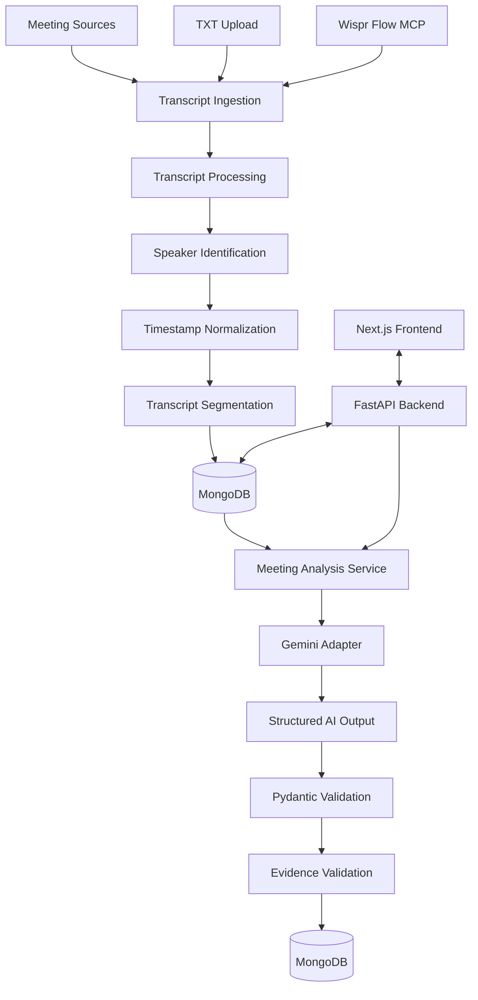

# DeciTrack — AI-Powered Meeting Intelligence & Decision Tracking

> **Turn conversations into clarity. Track decisions, commitments, and actions beyond the meeting.**

DeciTrack is an AI-powered meeting intelligence platform that transforms unstructured meeting conversations into structured, actionable, and traceable information.

It helps teams move beyond traditional meeting notes by identifying important decisions, proposed actions, commitments, unresolved questions, and follow-ups from meeting transcripts.

By combining meeting transcript ingestion, Wispr Flow integration, structured AI analysis, and persistent storage, DeciTrack creates a centralized record of what was discussed, what was decided, and what needs to happen next.

---

## 🚀 Key Features

### 1. Meeting Transcript Ingestion
- Upload meeting transcripts through TXT files.
- Retrieve recorded meetings and transcripts through Wispr Flow MCP integration.
- Parse transcript content and identify speaker information.
- Normalize timestamps into a consistent format.
- Divide transcripts into structured segments.
- Persist meeting metadata, speakers, and transcript segments in MongoDB.
- Retrieve stored transcripts for subsequent analysis.

### 2. Wispr Flow Integration
DeciTrack integrates with **Wispr Flow** through its Model Context Protocol (MCP) interface.

The integration enables:
- OAuth-authenticated MCP connectivity.
- Discovery and invocation of available Wispr tools.
- Searching for recently recorded meetings.
- Retrieving meeting metadata.
- Fetching complete meeting transcripts.
- Handling transcript pagination.
- Normalizing externally retrieved transcript data into DeciTrack's internal format.

This provides an integration path from recorded conversations to structured meeting intelligence.

### 3. AI-Powered Meeting Analysis
DeciTrack uses Gemini to analyze stored meeting transcripts and extract structured information.

The analysis pipeline identifies:

| Category | Description |
|---|---|
| Confirmed Decisions | Decisions explicitly agreed upon during the meeting |
| Proposed Decisions | Suggestions that have not yet been finalized |
| Actions | Tasks and activities identified during discussions |
| Commitments | Explicit promises or responsibilities |
| Questions | Unresolved questions requiring clarification |
| Tentative Proposals | Ideas that are still under consideration |

**Structured AI outputs:**
- Provider-neutral AI analysis interface.
- Gemini model adapter.
- Configurable Gemini model selection.
- Structured response validation using Pydantic v2.
- Evidence ID validation against the corresponding meeting transcript.
- Persistent storage of extracted meeting intelligence.

An important design principle is that extracted information must be traceable to the original meeting evidence rather than being treated as an unsupported AI-generated statement.

### 4. Structured Meeting Storage
MongoDB provides persistent storage for:
- Meeting metadata.
- Transcript segments.
- Speaker information.
- Extracted decisions.
- Proposed decisions.
- Action items.
- Commitments.
- Questions and tentative proposals.

The data model is designed to support subsequent retrieval and meeting intelligence workflows.

### 5. Meeting Management
- Centralized meeting records.
- Meeting listing and retrieval.
- Individual meeting details.
- Transcript access.
- Meeting analysis using stored transcript data.

---

## 🏗️ System Architecture

DeciTrack follows a modular client-server architecture.



### Architecture Principles

- **Modularity:** Separate ingestion, processing, analysis, and persistence layers.
- **Provider neutrality:** AI providers can be integrated through a common interface.
- **Evidence traceability:** AI-generated insights are associated with transcript evidence.
- **Validation-first:** Structured AI responses are validated before persistence.
- **Extensibility:** Designed to support additional integrations and meeting workflows.

---

## 🛠️ Technology Stack

| Layer | Technologies |
|---|---|
| Frontend | Next.js 16, TypeScript |
| Backend | Python, FastAPI |
| Database | MongoDB |
| Database Driver | PyMongo |
| Data Validation | Pydantic v2 |
| AI Model | Google Gemini |
| AI Integration | Provider-neutral adapter architecture |
| Meeting Integration | Wispr Flow MCP |
| Authentication | OAuth for Wispr Flow MCP |
| Configuration | Pydantic Settings, python-dotenv |
| ASGI Server | Uvicorn |
| Testing | Pytest, mocked integration tests |

---

## 📂 Project Structure

```text
DeciTrack/
│
├── decitrack-backend/
│   ├── app/
│   │   ├── api/
│   │   ├── services/
│   │   ├── models/
│   │   ├── database/
│   │   ├── integrations/
│   │   │   └── wispr/
│   │   └── ...
│   │
│   ├── tests/
│   │   └── manual/
│   ├── .env.example
│   ├── requirements.txt
│   └── ...
│
└── decitrack-frontend/
    └── decitrack-frontend/
        ├── app/
        ├── components/
        ├── public/
        ├── package.json
        └── ...
```

*The directory structure above illustrates the major project areas; individual module names may differ across implementation stages.*

---

## ⚙️ Getting Started

### Prerequisites

- Python 3.11+
- Node.js and npm
- MongoDB database
- Google Gemini API key
- Wispr Flow account with MCP access for the external meeting integration

### 1. Clone the Repository

```bash
git clone <YOUR_REPOSITORY_URL>
cd DeciTrack
```

### 2. Backend Setup

```bash
cd decitrack-backend

python -m venv venv
```

Activate the virtual environment:

**Windows**
```bash
venv\Scripts\activate
```

**Linux / macOS**
```bash
source venv/bin/activate
```

Install dependencies:

```bash
pip install -r requirements.txt
```

Configure the environment variables in your backend environment file.

```env
MONGODB_URI=your_mongodb_connection_string
GEMINI_API_KEY=your_gemini_api_key
GEMINI_MODEL=your_gemini_model
```

Add any additional integration and application settings required by your local configuration.

Start the backend:

```bash
uvicorn app.main:app --reload
```

The API documentation can be accessed at:

```text
http://localhost:8000/docs
```

### 3. Frontend Setup

Open another terminal:

```bash
cd decitrack-frontend/decitrack-frontend
```

Install dependencies:

```bash
npm install
```

Start the development server:

```bash
npm run dev -- --webpack
```

The frontend will be available at:

```text
http://localhost:3000
```

---

## 🔄 Core Workflow

DeciTrack follows a structured workflow to convert conversations into actionable intelligence.

**Step 1 — Capture**

Meeting transcripts enter the platform through manual TXT uploads or Wispr Flow integration.

**Step 2 — Process**

The backend parses the transcript, normalizes timestamps, handles speaker information, and generates structured transcript segments.

**Step 3 — Store**

Meeting information and transcript data are persisted in MongoDB.

**Step 4 — Analyze**

The analysis service retrieves the stored transcript and sends it to the configured Gemini model.

**Step 5 — Validate**

AI-generated outputs are validated using Pydantic. Evidence references are checked against the actual transcript belonging to the meeting.

**Step 6 — Persist Insights**

Validated decisions, proposals, commitments, questions, and actions are stored for subsequent retrieval.

**Step 7 — Access Intelligence**

The frontend provides access to meeting information and the resulting structured insights.

---

## 🧪 Testing

DeciTrack uses automated and mocked tests to verify important backend workflows.

Testing areas include:

- Transcript parsing and normalization.
- Speaker and timestamp handling.
- Transcript persistence and retrieval.
- Meeting data validation.
- Error handling during ingestion.
- AI response schema validation.
- Evidence ID ownership validation.
- Persistence of structured meeting analysis.
- Wispr integration behavior through controlled test scenarios.

Run the backend test suite:

```bash
pytest
```

Live external integration tests should be run separately and require valid integration credentials.

---

## 🔐 Security & Reliability

DeciTrack incorporates several validation-oriented design decisions:

- OAuth-based authentication for Wispr Flow MCP access.
- Environment-based configuration for sensitive credentials.
- Pydantic validation of structured AI outputs.
- Meeting-specific evidence reference validation.
- Separation of external integration logic from core application services.
- Validation before persisting AI-generated information.

API keys, OAuth credentials, and database connection strings should never be committed to version control.

---

## 🔮 Future Enhancements

The architecture provides room for additional meeting intelligence capabilities:

- **Decision Lifecycle Tracking:** Track decisions from proposal through approval and completion.
- **Action Item Ownership:** Associate tasks with responsible participants and deadlines.
- **Decision History:** Maintain a chronological history of decisions and changes.
- **Evidence Exploration:** Navigate from extracted insights directly to their supporting transcript segments.
- **Meeting-to-Meeting Intelligence:** Identify recurring topics, unresolved questions, and repeated commitments across meetings.
- **Follow-up Automation:** Generate reminders for outstanding commitments.
- **Project Management Integrations:** Connect extracted action items with external task management platforms.
- **Advanced Analytics:** Visualize decision patterns, task completion, and meeting outcomes.

---

## 💡 Why DeciTrack?

Traditional meeting tools focus primarily on recording conversations or generating summaries.

DeciTrack focuses on something more useful: **what the conversation actually establishes and what happens after it ends.**

Instead of treating a meeting as a document, DeciTrack treats it as a source of structured organizational knowledge.

Its emphasis on evidence-backed extraction, validated AI outputs, and persistent decision records helps bridge the gap between conversations and execution.

---

## 👩‍💻 Project

**DeciTrack — AI-Powered Meeting Intelligence & Decision Tracking**

Built using FastAPI, MongoDB, Next.js, Gemini, and Wispr Flow MCP.

